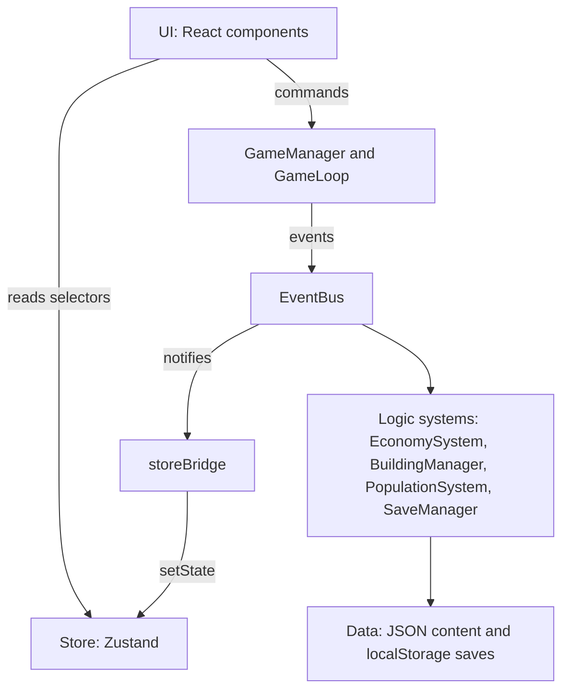

# civ-idle-game

Браузерная экономическая idle/management-игра о развитии цивилизации: от
средневековой деревушки до планетарной империи. Игрок не кликает, а управляет:
распределяет рабочие руки, задаёт приоритеты, строит здания, следит за
потреблением, износом и исследованиями.

Целевая площадка — Яндекс.Игры, язык — только русский, десктоп-первый интерфейс,
оффлайн-прогресса нет.

> Основная логика игры реализована: ресурсы, здания, население, экономический
> цикл и сохранение одного слота. Не реализован интерфейс управления зданиями и
> населением; исследования, эпохи, события, деньги и война пока вне текущего
> прототипа. Актуальный статус — в [`docs/status.md`](docs/status.md).

## Статус

Снимок на 2026-11-27.

**Уже работает:**

- игровой цикл: тик 1000 мс на x1, пауза, x2/x5, fast-forward на 100 шагов;
- ресурсы: склады и бонусы складов зданий, возобновляемые природные пулы,
  порча излишков, transient-поток `BuildPower`, история баланса с лимитом;
- распределение запросов на ресурсы по приоритетам (`ResourceManager`);
- здания: производство и потребление, рабочие по приоритетам,
  power/efficiency/level, износ и ремонт, HP и урон, очередь строительства,
  снос;
- население: потребление еды и воды, жильё, рост и смертность,
  бунт/забастовка, гражданская война и поражение, распределение рабочих;
- ручное сохранение и загрузка в один слот `localStorage` (ресурсы, здания,
  население);
- UI: панель ресурсов, номер хода, управление скоростью, save/load;
- архитектурный каркас: EventBus, GameManager, GameLoop, Store, Bridge;
- автотесты: Vitest 4.1.12, 298 зелёных тестов, включая валидацию контента.

**Осталось реализовать:**

- UI зданий, очереди строительства, населения, предупреждений и экран
  поражения;
- исследования, эпохи, случайные события, деньги и войну;
- 9 слотов сохранений, автосейв, версии и миграции;
- интеграцию с Яндекс.Играми (SDK, cloud saves, лидерборды, реклама);
- исправление известных UI-расхождений: `storage = 0` и фильтр `open`.

Подробная таблица по механикам, известные баги и текущие задачи —
[`docs/status.md`](docs/status.md).

## Стек

| Слой | Технологии |
|---|---|
| UI | React 19.2.4, Next.js 16.2.10 (App Router), Tailwind CSS 4, React Compiler |
| Состояние UI | Zustand 5.0.14 |
| Логика | TypeScript strict, собственный EventBus, `break_infinity.js` (`Decimal`) |
| Данные | JSON-контент в `src/data`, сохранения в `localStorage` |
| Тесты | Vitest 4.1.12, jsdom, `@vitest/coverage-v8` |

## Быстрый старт

Требуется Node.js 20.9+ (LTS) и npm.

```bash
npm install
npm run dev
```

Приложение будет доступно по адресу [http://localhost:3000](http://localhost:3000).
Игровой цикл и bridge инициализируются на клиенте в
[`src/app/page.tsx`](src/app/page.tsx).

Сборка и локальный запуск production-версии:

```bash
npm run build
npm start
```

## Скрипты

| Команда | Назначение |
|---|---|
| `npm run dev` | dev-сервер Next.js, основной способ ручной проверки |
| `npm run build` | production-сборка |
| `npm start` | запуск собранного приложения |
| `npm run lint` | ESLint |
| `npm run test` | Vitest, один прогон |
| `npm run test:watch` | Vitest в watch-режиме |
| `npm run test:coverage` | Vitest с отчётом покрытия |

## Архитектура

Проект построен на трёх слоях — представление, логика и данные. Store и Bridge
не являются доменными слоями: это механизмы связи.



Ключевые правила:

- `src/logic/**` не импортирует store, `GameState` и UI;
- `useGameStore.setState` вызывается только в
  [`src/integration/storeBridge.ts`](src/integration/storeBridge.ts);
- `GameLoop` и `GameManager` создаются только через `getGameLoop()` /
  `getGameManager()`, синглтоны живут на `globalThis`;
- между системами общение идёт только через `EventBus`; внутри одной системы
  менеджеры могут вызывать публичные методы друг друга;
- `EconomySystem.runTurn` фиксирует порядок фаз; менеджеры не подписываются
  на `tick` самостоятельно;
- ресурсы меняет только `ResourceManager` — остальные передают
  `ResourceRequest[]`;
- UI читает только store и отправляет команды через публичные фасады.

Основные модули:

| Модуль | Ответственность |
|---|---|
| [`src/logic/EventBus.ts`](src/logic/EventBus.ts) | `on`/`off`/`emit`, единственный канал межсистемного общения |
| [`src/logic/GameManager.ts`](src/logic/GameManager.ts) | оркестратор и фасад команд `send(event, payload)` |
| [`src/logic/GameLoop.ts`](src/logic/GameLoop.ts) | тик, скорость, пауза, fast-forward, SSR-guard |
| [`src/logic/services/Economy/EconomySystem.ts`](src/logic/services/Economy/EconomySystem.ts) | `runTurn`, порядок фаз, `EconomySnapshot`, сохранение экономики |
| [`src/logic/services/Economy/ResourceSystem/`](src/logic/services/Economy/ResourceSystem) | `ResourceManager`: единственный владелец ресурсов, запросы, склады, порча, transient-потоки |
| [`src/logic/services/Economy/BuildingSystem/`](src/logic/services/Economy/BuildingSystem) | `BuildingManager`: производство, рабочие, износ, ремонт, строительство, урон |
| [`src/logic/services/Economy/PopulationSystem/`](src/logic/services/Economy/PopulationSystem) | `PopulationSystem`: потребление, демография, бунт, гражданская война |
| [`src/logic/services/GameSave/`](src/logic/services/GameSave) | сохранения через контракт `Saveable` |
| [`src/store/gameStore.ts`](src/store/gameStore.ts) | Zustand-состояние для UI |
| [`src/integration/storeBridge.ts`](src/integration/storeBridge.ts) | EventBus → `serialize()` → store |

Подробности и инварианты — [`docs/architecture.md`](docs/architecture.md).

## Структура проекта

```text
src/
  app/            # Next.js App Router: layout, page, глобальные стили
  components/     # UI: панель ресурсов, кнопки сохранения и загрузки
  data/           # контент v1; generators.json и resources.json — легаси
  hooks/          # легаси-хуки, не используются в v1
  integration/    # storeBridge и его тесты
  logic/          # EventBus, GameLoop, GameManager, сервисы
    services/
      Economy/
        EconomySystem.ts
        ResourceSystem/   # Resource, ResourceManager
        BuildingSystem/   # Building, BuildingManager
        PopulationSystem/ # PopulationSystem
      GameSave/           # SaveManager и контракт Saveable
  shared/types/   # общие типы слоёв
  store/          # Zustand store
  test/           # setup, helpers, fixtures для тестов
docs/             # дизайн, архитектура, статус, парадигма тестов, решения
```

## Документация

| Документ | О чём |
|---|---|
| [`docs/game-design_v1.md`](docs/game-design_v1.md) | правила игры, формулы, механики, схема контента — источник истины для поведения |
| [`docs/architecture.md`](docs/architecture.md) | слои, ответственность модулей, контракты, инварианты |
| [`docs/status.md`](docs/status.md) | что реализовано, что заглушка, известные расхождения |
| [`docs/testing.md`](docs/testing.md) | парадигма тестирования, уровни, границы слоёв |
| [`docs/decisions.md`](docs/decisions.md) | журнал архитектурных и геймдизайн-решений |
| [`AGENTS.md`](AGENTS.md) | правила работы с репозиторием для разработчиков и агентов |

Если документы противоречат друг другу, конфликт фиксируется и уточняется, а не
разрешается молча.

## Тесты

Тесты лежат рядом с кодом (`src/logic/**/*.test.ts`,
`src/integration/**/*.test.ts`), общая инфраструктура — в `src/test/`
(setup, helpers, fixtures). Ожидаемое поведение берётся из дизайн-документа, а
не из текущей реализации.

Снимок на 2026-11-27: 298 зелёных тестов. Покрыты unit-тесты логики,
интеграция bridge и сохранений, валидация контента. Component- и E2E-тесты
ещё не реализованы.

Новое поведение разрабатывается по TDD: тесты → красная стадия → заморозка
тестов → реализация. Замороженные тесты не меняются без явного разрешения.

```bash
npm run test
npm run test:coverage
```

Известный баг оформляется как `test.fails` с комментарием и ссылкой на
[`docs/status.md`](docs/status.md); после исправления тест становится обычным.
Уровни тестирования и TDD-границы — в [`docs/testing.md`](docs/testing.md).

## Известные проблемы

Кратко, полный список — в [`docs/status.md`](docs/status.md), раздел 9:

- `storage: 0` отображается в UI как `∞`, хотя по дизайну это нулевая
  вместимость;
- закрытые ресурсы не фильтруются по `open`, `Money` виден игроку;
- сейв имеет двойную вложенность `economy.resourcesManager.resourcesManager`;
- сохранение до первого тика не учитывает бонусы складов зданий, после
  загрузки склад не восстанавливается;
- bridge идемпотентен в рамках модуля, но при HMR возможна повторная подписка;
- комментарий в `ResourceRequest` говорит «0 — самый высокий», хотя код и
  дизайн трактуют `0` как самый низкий приоритет;
- тест порчи использует `BuildPower` и после перехода на transient-поток
  проверяет сброс потока, а не порчу излишков;
- `Generator`, `generators.json`, `resources.json` и `useGameState` — легаси
  кликер-прототипа, в v1 не входят.

## Ближайшие шаги

1. **UI MVP.** Панели зданий, очереди строительства, населения и
   предупреждений; экран поражения; исправление `storage = 0` и фильтра
   `open`; компонентные тесты.
2. **Сохранения MVP.** Полное состояние игры в слоте, версия и миграции,
   устранение двойной вложенности, автосейв.
3. **Yandex SDK.** Сбор требований платформы, адаптер, lifecycle и cloud
   saves; SDK не импортируется в `src/logic/**`.
4. **После MVP.** 9 слотов и панель сохранений, исследования, эпохи, события,
   деньги и война.

## Разработка

- Одна задача — одно изменение: не смешивайте рефакторинг, фичу и тесты.
- Перед изменением кода прочитайте релевантные документы и определите слой.
- Не добавляйте зависимости, не меняйте `src/data/*.json`, `next.config.ts`,
  `tsconfig.json` и `package.json` без запроса.
- Не переписывайте `EventBus` и не переименовывайте файлы, классы и события
  «для красоты».

Проверки перед завершением задачи:

```bash
npm run lint
npx tsc --noEmit
npm run test
npm run build
```

Полные правила — в [`AGENTS.md`](AGENTS.md).
