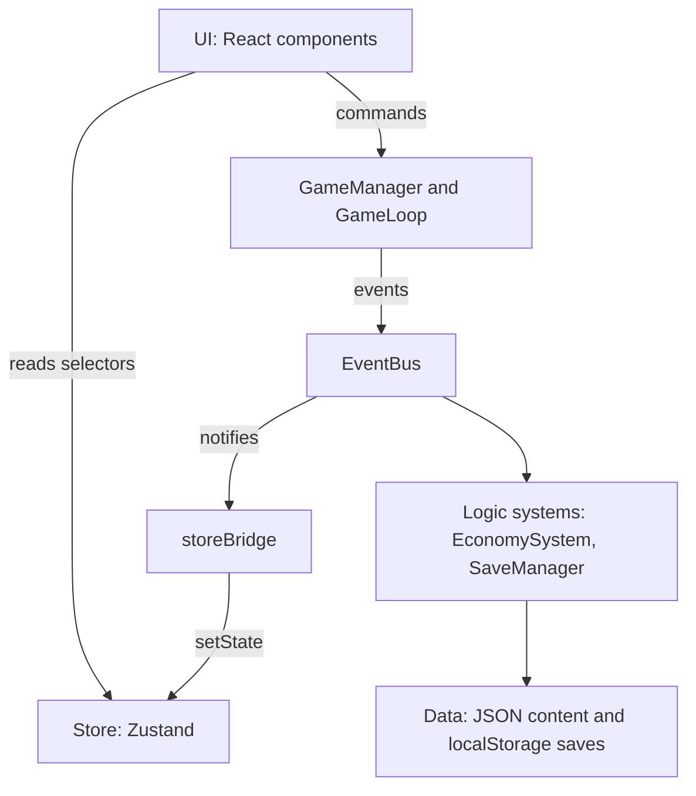

# civ-idle-game

Браузерная экономическая idle/management-игра о развитии цивилизации: от
средневековой деревушки до планетарной империи. Игрок не кликает, а управляет:
распределяет рабочие руки, задаёт приоритеты, строит здания, следит за
потреблением, износом и исследованиями.

Целевая площадка — Яндекс.Игры, язык — только русский, десктоп-первый интерфейс,
оффлайн-прогресса нет.

> Проект находится в активной разработке. Играбельный прототип сейчас — это
> ресурсы и игровой тик; большая часть дизайна v1 ещё не реализована.
> Актуальный статус — в [`docs/status.md`](docs/status.md).

## Статус

Снимок на 2026-11-24.

**Уже работает:**

- игровой цикл: тик 1000 мс на x1, пауза, x2/x5, fast-forward на 100 шагов;
- ресурсы: склады, возобновляемые природные пулы, история баланса;
- распределение запросов на ресурсы по приоритетам (`ResourceManager`);
- ручное сохранение и загрузка в один слот `localStorage`;
- UI: панель ресурсов, номер хода, управление скоростью, save/load;
- архитектурный каркас: EventBus, GameManager, GameLoop, Store, Bridge;
- автотесты: Vitest, 129 тестов + 1 ожидаемо падающий, покрытие `src/logic`
  100% по statements/lines.

**Ещё не реализовано:**

- здания: производство/потребление, рабочие, power/efficiency/level, ремонт;
- строительство, очередь проектов и `BuildPower` как поток;
- население: потребление, рост, смертность, бунт, гражданская война;
- исследования, эпохи, события, деньги, война;
- 9 слотов сохранений, автосейв, версии и миграции;
- интеграция с Яндекс.Играми (SDK, cloud saves, лидерборды, реклама);
- полные UI-панели зданий, населения, исследований и сохранений.

Подробная таблица по механикам, известные баги и ближайшие шаги —
[`docs/status.md`](docs/status.md).

## Стек

| Слой | Технологии |
|---|---|
| UI | React 19, Next.js 16 (App Router), Tailwind CSS 4, React Compiler |
| Состояние UI | Zustand 5 |
| Логика | TypeScript strict, собственный EventBus, `break_infinity.js` (`Decimal`) |
| Данные | JSON-контент в `src/data`, сохранения в `localStorage` |
| Тесты | Vitest 4, jsdom, `@vitest/coverage-v8` |

## Быстрый старт

Требуется Node.js 20.9+ (LTS) и npm.

```bash
npm install
npm run dev
```

Приложение будет доступно по адресу [http://localhost:3000](http://localhost:3000).
Игровой цикл и bridge инициализируются на клиенте в
[`src/app/page.tsx`](src/app/page.tsx).

Сборка и локальный запуск production-версии:

```bash
npm run build
npm start
```

## Скрипты

| Команда | Назначение |
|---|---|
| `npm run dev` | dev-сервер Next.js, основной способ ручной проверки |
| `npm run build` | production-сборка |
| `npm start` | запуск собранного приложения |
| `npm run lint` | ESLint |
| `npm run test` | Vitest, один прогон |
| `npm run test:watch` | Vitest в watch-режиме |
| `npm run test:coverage` | Vitest с отчётом покрытия |

## Архитектура

Проект построен на трёх слоях — представление, логика и данные. Store и Bridge
не являются доменными слоями: это механизмы связи.



Ключевые правила:

- `src/logic/**` не импортирует store, `GameState` и UI;
- `useGameStore.setState` вызывается только в
  [`src/integration/storeBridge.ts`](src/integration/storeBridge.ts);
- `GameLoop` и `GameManager` создаются только через `getGameLoop()` /
  `getGameManager()`, синглтоны живут на `globalThis`;
- между системами общение идёт только через `EventBus`; внутри одной системы
  менеджеры могут вызывать публичные методы друг друга;
- ресурсы меняет только `ResourceManager` — остальные передают
  `ResourceRequest[]`;
- UI читает только store и отправляет команды через публичные фасады.

Основные модули:

| Модуль | Ответственность |
|---|---|
| [`src/logic/EventBus.ts`](src/logic/EventBus.ts) | `on`/`off`/`emit`, единственный канал межсистемного общения |
| [`src/logic/GameManager.ts`](src/logic/GameManager.ts) | оркестратор и фасад команд `send(event, payload)` |
| [`src/logic/GameLoop.ts`](src/logic/GameLoop.ts) | тик, скорость, пауза, fast-forward, SSR-guard |
| [`src/logic/services/Economy/`](src/logic/services/Economy) | экономика: `EconomySystem`, `ResourceSystem`, будущие здания и население |
| [`src/logic/services/GameSave/`](src/logic/services/GameSave) | сохранения через контракт `Saveable` |
| [`src/store/gameStore.ts`](src/store/gameStore.ts) | Zustand-состояние для UI |
| [`src/integration/storeBridge.ts`](src/integration/storeBridge.ts) | EventBus → `serialize()` → store |

Подробности и инварианты — [`docs/architecture.md`](docs/architecture.md).

## Структура проекта

```text
src/
  app/            # Next.js App Router: layout, page, глобальные стили
  components/     # UI: панель ресурсов, кнопки сохранения и загрузки
  data/           # статический контент игры, только чтение
  hooks/          # легаси-хуки, не используются в v1
  integration/    # storeBridge и его тесты
  logic/          # EventBus, GameLoop, GameManager, сервисы
    services/
      Economy/    # EconomySystem, ResourceSystem, BuildingSystem, PopulationSystem
      GameSave/   # SaveManager и контракт Saveable
  shared/types/   # общие типы слоёв
  store/          # Zustand store
  test/           # setup, helpers, fixtures для тестов
docs/             # дизайн, архитектура, статус, журнал решений
plans/            # стратегия тестирования и планы этапов
```

## Документация

| Документ | О чём |
|---|---|
| [`docs/game-design_v1.md`](docs/game-design_v1.md) | правила игры, формулы, механики, схема контента — источник истины для поведения |
| [`docs/architecture.md`](docs/architecture.md) | слои, ответственность модулей, контракты, инварианты |
| [`docs/status.md`](docs/status.md) | что реализовано, что заглушка, известные расхождения |
| [`docs/decisions.md`](docs/decisions.md) | журнал архитектурных и геймдизайн-решений |
| [`plans/testing-strategy.md`](plans/testing-strategy.md) | уровни тестов, стек, порядок покрытия |
| [`AGENTS.md`](AGENTS.md) | правила работы с репозиторием для разработчиков и агентов |

Если документы противоречат друг другу, конфликт фиксируется и уточняется, а не
разрешается молча.

## Тесты

Тесты лежат рядом с кодом (`src/logic/**/*.test.ts`,
`src/integration/**/*.test.ts`), общая инфраструктура — в `src/test/`
(setup, helpers, fixtures). Ожидаемое поведение берётся из дизайн-документа, а
не из текущей реализации.

```bash
npm run test
npm run test:coverage
```

Известный баг оформляется как `test.fails` с комментарием и ссылкой на
[`docs/status.md`](docs/status.md); после исправления тест становится обычным.
Уровни тестирования и планы по E2E и Yandex SDK — в
[`plans/testing-strategy.md`](plans/testing-strategy.md).

## Известные проблемы

Кратко, полный список — в [`docs/status.md`](docs/status.md), раздел 9:

- `storage: 0` отображается в UI как `∞`, хотя по дизайну это нулевая
  вместимость;
- закрытые ресурсы не фильтруются по `open`, `Money` виден игроку;
- сейв имеет двойную вложенность `economy.resourcesManager.resourcesManager`;
- история баланса растёт без ограничения;
- `Generator`, `generators.json`, `resources.json` и `useGameState` — легаси
  кликер-прототипа, в v1 не входят.

## Ближайшие шаги

1. Привести контент к схеме v1: `BuildPower`, `spoilRate`, `era`, обязательные
   поля зданий и населения.
2. Реализовать порядок фаз хода и transient-ресурсы.
3. Реализовать `BuildingManager` и `PopulationSystem`, покрыть их тестами.
4. Сделать 9 слотов сохранений, автосейв, версии и миграции.
5. Добавить UI зданий, населения, исследований и сохранений.
6. Подключить Yandex SDK через адаптер и cloud saves.

## Разработка

- Одна задача — одно изменение: не смешивайте рефакторинг, фичу и тесты.
- Перед изменением кода прочитайте релевантные документы и определите слой.
- Не добавляйте зависимости, не меняйте `src/data/*.json`, `next.config.ts`,
  `tsconfig.json` и `package.json` без запроса.
- Не переписывайте `EventBus` и не переименовывайте файлы, классы и события
  «для красоты».

Проверки перед завершением задачи:

```bash
npm run lint
npx tsc --noEmit
npm run test
npm run build
```

Полные правила — в [`AGENTS.md`](AGENTS.md).
