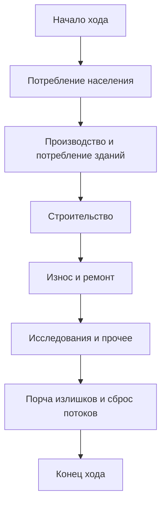

# Дизайн-документ v1: экономическая idle-игра о цивилизации

> **Статус документа:** проектная спецификация v1. Описывает, какой игра должна быть.
> Не описывает текущую реализацию — для этого предназначен `docs/status.md`.
> Не описывает архитектуру — для этого предназначен `docs/architecture.md`.
>
> **Основа:** `docs/game-design.md`, текущий контент `src/data/*.json`, уже реализованные механики.
> **Область:** игровые правила, механики, контент-схема, требования к UI, балансные ориентиры.
> **Вне области:** классы, слои, EventBus, store, bridge, тесты и прочая архитектура.

---

## Содержание

1. [Обзор игры](#1-обзор-игры)
2. [Ключевые принципы](#2-ключевые-принципы)
3. [Термины и единицы](#3-термины-и-единицы)
4. [Игровой цикл и время](#4-игровой-цикл-и-время)
5. [Ресурсы](#5-ресурсы)
6. [Здания](#6-здания)
7. [Строительство](#7-строительство)
8. [Население](#8-население)
9. [Дефицит и приоритеты](#9-дефицит-и-приоритеты)
10. [Исследования](#10-исследования)
11. [Эпохи и прогрессия](#11-эпохи-и-прогрессия)
12. [Деньги, война, события](#12-деньги-война-события)
13. [UI и общий вид](#13-ui-и-общий-вид)
14. [Сохранения](#14-сохранения)
15. [Контент и схема данных](#15-контент-и-схема-данных)
16. [Балансные ориентиры](#16-балансные-ориентиры)
17. [Граничные случаи](#17-граничные-случаи)
18. [Решения v1](#18-решения-v1)
19. [Открытые вопросы](#19-открытые-вопросы)
20. [Журнал изменений](#20-журнал-изменений)

---

## 1. Обзор игры

### 1.1. Жанр и фантазия

Экономическая idle/management-игра. Игрок управляет цивилизацией на пути от средневековой деревушки до космической империи. Основной упор — на менеджмент, автоматизацию, управление потоками ресурсов, развитие поселения и его эволюцию:

**деревня → город → небольшое графство → страна → сверхдержава → планетарная цивилизация → дальше.**

Игрок — не герой и не кликер. Он управленец: задаёт приоритеты, распределяет рабочие руки, строит здания, принимает решения о потреблении, ремонте, исследованиях и обороне.

### 1.2. Платформа и рамки

- Браузерная игра, целевая площадка — Яндекс.Игры.
- Десктоп-первый интерфейс; адаптивность под мобильные устройства закладывается сразу, но мобильный UX не является приоритетом v1.
- Язык — только русский (RU).
- Оффлайн-прогресс не предусмотрен.
- Премиум-валюты и доната нет. Если в игре появляются деньги, это только игровая валюта.
- Активных действий кликом/тапом нет.

### 1.3. Сессия и длительность

- Целевой длины сессии пока нет.
- Первая эпоха: минимум **1500 игровых шагов**, ориентир **20–30 минут** при скорости x1.
- Полная игра ведёт игрока сквозь эпохи; текущая разработка сосредоточена на первой эпохе.

### 1.4. Условия завершения

- **Поражение:** полное вымирание населения. Дополнительно гражданская война может привести к поражению (см. раздел 8).
- **Победы нет:** прогрессия бесконечная, эпохи сменяют друг друга. Завершение эпохи — этап прогрессии, а не финал игры.
- Другие условия поражения находятся в разработке.

### 1.5. Что входит в полную версию 1

В полную версию 1 входят:

- ресурсы;
- здания;
- строительство;
- население;
- износ и урон;
- бунт;
- исследования;
- армия и набеги;
- деньги;
- случайные события.

В документе описаны все механики полной версии 1. Текущий статус реализации фиксируется отдельно, в `docs/status.md`.

---

## 2. Ключевые принципы

1. **Игрок управляет, а не кликает.** Ценность игры — в решениях о потоках, приоритетах и развитии.
2. **Экономика — это запасы и потоки.** Дефицит должен создавать выбор, а не просто блокировать кнопки.
3. **Ход детерминирован.** Все события хода разрешаются в фиксированном порядке фаз.
4. **Внутри фазы производства нет обратной связи.** Ресурс, произведённый зданием, не может быть потреблён другим зданием в том же ходу. Он станет доступен на следующем ходу. Исключение — строительные мощности, которые являются потоком и используются в фазе строительства того же хода.
5. **Приоритеты — главный инструмент игрока.** При дефиците ресурсов и рабочих рук порядок приоритетов определяет, кто работает первым.
6. **Автоматизация — цель развития.** Игрок не должен вручную повторять одно и то же каждые несколько секунд.
7. **Поражение возможно, но не внезапно.** Игрок должен получать предупреждения о голоде, бунте, износе и гражданской войне.
8. **Контент расширяем.** Новые ресурсы, здания, население, исследования и эпохи должны добавляться через данные, а не через переписывание правил.

---

## 3. Термины и единицы

| Термин | Определение |
|---|---|
| **Ход (tick)** | Один шаг игровой симуляции. При скорости x1 длится 1 секунду. |
| **Игровая скорость** | Пауза, x1, x2, x5, fast-forward на N шагов. Влияет только на реальное время между ходами, не на ставки за ход. |
| **Ставка за ход** | Количество ресурса, производимое/потребляемое за один ход. Все числа контента — за ход. |
| **Ресурс** | Тип запаса или потока: древесина, вода, еда, железо и т.д. |
| **Природный пул** | Запас ресурса в природе. Игрок его не создаёт, а добывает. |
| **Склад игрока** | Запас ресурса, принадлежащий игроку. |
| **Природный ресурс** | Ресурс, который добывается из природы. Бывает возобновляемым и невозобновляемым. |
| **Искусственный ресурс** | Ресурс, который производит игрок; в природе он не встречается. |
| **Добыча** | Перевод ресурса из природного пула на склад игрока. |
| **Переработка** | Потребление ресурсов игрока и производство других ресурсов игрока. |
| **Вместимость склада** | Максимальный запас ресурса без порчи. |
| **Порча** | Потеря излишка сверх вместимости склада. Темп порчи индивидуален для ресурса. |
| **BuildPower** | Строительные мощности. Поток, а не запас: не хранится и не переносится на следующий ход. |
| **ResearchPoints (RP)** | Очки исследований. Поток, производимый исследовательскими зданиями; накапливаются внутри активного исследования; не хранятся на обычном складе. |
| **Power** | Ручной регулятор нагрузки здания, 0–100. |
| **Efficiency** | Производный множитель эффективности здания. |
| **Decay** | Износ группы зданий; может превышать 100%. Снижает эффективность; при >=100% группа разрушается на следующем ходу. |
| **HP** | Прочность здания. Внешний урон уменьшает HP; при 0 здание разрушается. |
| **Level** | Уровень группы зданий. Влияет на производство и стоимость. |
| **Priority** | Приоритет 0–30. 1 — самый высокий, 2–30 — ниже, 0 — самый низкий. |
| **Satisfaction** | Удовлетворённость населения, 0–1. |
| **Rebellion** | Уровень бунта, 0–1. |
| **Era** | Эпоха: набор контента, правил и целей. |

---

## 4. Игровой цикл и время

### 4.1. Модель времени

Игра использует пошаговую симуляцию с реальным отображением:

- 1 ход = 1 секунда при x1;
- x2 = 2 хода в секунду;
- x5 = 5 ходов в секунду;
- пауза = ходы не идут;
- fast-forward = N ходов подряд с заданной скоростью.

Все ставки в контенте задаются **за ход**. Скорость не меняет экономику, только реальное время между ходами.

### 4.2. Порядок фаз хода

Порядок фаз фиксирован:



1. **Потребление населения.** Еда и вода списываются со склада игрока.
2. **Производство и потребление зданий.** Здания формируют запросы на ресурсы; дефицит распределяется по приоритетам.
3. **Строительство.** Расходуются buildPower и материалы; завершаются проекты.
4. **Износ и ремонт.** Износ начисляется (может превысить 100%), затем выполняется доступный ремонт. Если на начало фазы износ >= 100%, вся группа зданий разрушается; если после ремонта износ остаётся >= 100%, группа разрушается на следующем ходу.
5. **Исследования и прочее.** Производится RP, продвигаются исследования, обрабатываются события.
6. **Конец хода.** Излишки сверх складов портятся, потоки сбрасываются, история баланса записывается, номер хода увеличивается.

### 4.3. Правило отсутствия обратной связи

Внутри **фазы производства** действует строгое правило:

- все здания считают свои запросы от запаса ресурсов на начало фазы;
- ресурсы, произведённые в этой фазе, не могут быть потреблены другими зданиями в том же ходу;
- произведённые ресурсы становятся доступны на следующем ходу.

Между фазами обратная связь допустима и определяется порядком фаз:

- строительство может использовать материалы и buildPower, произведённые в этом ходу;
- RP, произведённые в этом ходу, идут в шкалу активного исследования;
- новые здания, завершённые в фазе строительства, начинают работать только со следующего хода.

### 4.4. Пауза и fast-forward

- На паузе фазы не выполняются; UI показывает последнее состояние.
- Fast-forward выполняет N полных ходов по тем же правилам; промежуточные состояния в UI не обязательны.
- Изменение скорости не влияет на ставки за ход.

### 4.5. Оффлайн-прогресс

Оффлайн-прогресса нет. При возврате в игру состояние продолжается с сохранённого хода; пропущенное реальное время не компенсируется.

---

## 5. Ресурсы

### 5.1. Два типа ресурсов

**Природные ресурсы:**

- добываются из природы;
- игрок не может их создать;
- бывают возобновляемыми и невозобновляемыми;
- имеют природный пул и вместимость природного пула.

**Искусственные ресурсы:**

- производятся игроком при переработке;
- в природе не встречаются;
- в будущем могут добываться другими способами (война, руины в космосе и т.д.).

### 5.2. Два пула одного ресурса

Один и тот же ресурс может существовать в двух пулах:

- **природный пул** — запас в природе;
- **склад игрока** — добытый/произведённый запас.

Например, вода в природе и вода на складе игрока — один ресурс, но два пула и две вместимости.

В контенте пулы могут быть представлены разными записями:

| Природный пул | Склад игрока | Смысл |
|---|---|---|
| `WaterDeposit` | `Water` | Вода |
| `Tree` | `Wood` | Древесина |
| `StoneDeposit` | `Stone` | Камень |
| `IronOreDeposit` | `IronOre` | Железная руда |

Это разделение нужно для ясности UI и правил добычи. Игрок видит природные запасы отдельно от своих складов.

### 5.3. Природные ресурсы

- Природный пул имеет начальное количество и вместимость.
- **Возобновляемые:** каждый ход пул растёт на `count × renewRate`, но не выше вместимости.
- Если пул равен 0, прирост равен 0: полное исчерпание останавливает воспроизводство.
- **Невозобновляемые:** прироста нет; запас конечен.
- Добывающие здания переводят ресурс из природного пула на склад игрока.
- Перерабатывающие здания **не потребляют природный пул напрямую**. Им нужен ресурс на складе игрока.
- При истощении пула добыча останавливается; здание простаивает.
- Геологоразведка добавляет ресурсы в природный пул и расширяет его вместимость на то же значение.
- Разведанный пул игрока может отличаться от истинного пула планеты. В будущем истинный пул может истощаться полностью; тогда геологоразведка не поможет и потребуется искать новые источники (например, астероиды). В v1 отдельный истинный пул не создаётся — это задел на будущее.
- Новые месторождения могут открываться исследованиями (геологоразведка), захватом территорий и т.д. — в будущих эпохах.

### 5.4. Склады и порча

Вместимость склада игрока:

```text
S = baseStorage + Σ(storageBonus_i × owned_i)
```

где:

- `baseStorage` — базовая вместимость из контента ресурса;
- `storageBonus_i` — бонус i-го типа зданий;
- `owned_i` — количество построенных зданий i-го типа.

Правило v1:

- `storage: 0` означает **нулевую базовую вместимость**, а не бесконечность.
- UI должен показывать `0`, а не `∞`.
- На старте CentralBase даёт базовые склады, поэтому стартовые ресурсы не исчезают в первый же ход.

Порча излишка:

```text
excess = max(0, count − S)
lost = excess × spoilRate
count = count − lost
```

- `spoilRate` задаётся индивидуально для ресурса.
- `spoilRate = 1` — излишек исчезает сразу.
- `spoilRate = 0` — излишек не портится (использовать осторожно; по умолчанию такого нет).
- Примеры: еда — 0.02 (примерно 50 ходов), вода — 0.05 (примерно 20 ходов), древесина/камень/железо/уголь — 0.01 (примерно 100 ходов).
- Конкретные значения — балансные параметры.

Природные пулы не портятся; у них своя вместимость.

### 5.5. BuildPower как поток

`BuildPower` — особый ресурс:

- не хранится на складе;
- производится зданиями каждый ход;
- используется в фазе строительства этого же хода;
- неиспользованный остаток исчезает в конце хода;
- не переносится на следующий ход.

Это соответствует правилу: строительные мощности — поток, а не запас.

### 5.6. Добыча и переработка

Текущие производственные цепочки:

| Здание | Тип | Потребляет | Производит |
|---|---|---|---|
| Колодец | Добыча | `WaterDeposit` | `Water` |
| Лесопилка | Добыча | `Tree` | `Wood` |
| Каменоломня | Добыча | `StoneDeposit` | `Stone` |
| Шахта железа | Добыча | `IronOreDeposit` | `IronOre` |
| Углежог | Переработка | `Wood` | `Charcoal` |
| Плавильная печь железа | Переработка | `Charcoal`, `IronOre` | `Iron` |
| Ферма | Переработка | `Water` | `Food` |

Правило: **производственные здания не потребляют природные пулы напрямую.** Сначала ресурс должен быть добыт на склад игрока.

### 5.7. Видимость и разблокировка

- Каждый ресурс имеет флаг `open`.
- Закрытые ресурсы полностью скрыты от игрока.
- Ресурсы открываются исследованиями, эпохами или событиями.
- Природные ресурсы могут быть скрыты до геологоразведки.
- В v1 все текущие ресурсы, кроме `Money`, открыты; `Money` зарезервирован под будущую валюту.

### 5.8. Стартовые ресурсы

Стартовое состояние берётся из контента:

- ресурсы с `count > 0` есть на старте;
- здания с `owned > 0` есть на старте;
- население с `count > 0` есть на старте.

Текущий базовый старт:

- CentralBase — 1;
- крестьяне — 10;
- Wood — 400;
- Water — 1000;
- Food — 1000;
- Iron — 50;
- IronOre — 50;
- Stone — 200;
- Charcoal — 50.

Стартовые запасы не должны превышать стартовую вместимость складов; CentralBase обеспечивает начальную вместимость.

### 5.9. Деньги

- В игре предполагается только игровая валюта.
- Премиум-валюты и доната нет.
- Деньги запланированы как отдельная механика; в первой эпохе они не являются обязательными.
- Назначение денег: торговля, дипломатия, налоги, а также обычный ресурс для содержания (например, оплата солдатам: еда, вода, жильё, деньги).
- Конкретная реализация денег — в разработке.

---

## 6. Здания

### 6.1. Категории

Категория — это группировка для UI; поведение здания определяется его `produces`/`consumes` и правилами.

Базовые категории:

- **production** — добыча и переработка;
- **storage** — склады;
- **infrastructure** — базовая инфраструктура, строительные мощности;
- **housing** — жильё;
- **research** — исследования (запланировано);
- **military** — военные здания (запланировано).

### 6.2. Производство и потребление

У каждого типа зданий есть базовые `produces` и `consumes` за ход. Количество зданий умножает базовые значения.

Итоговая ставка здания:

```text
workerFill = min(1, assignedWorkers / workersRequired)      // 1, если workersRequired = 0
decayFactor = max(0, 1 − decayLevel / 100)
efficiency = workerFill × decayFactor
levelProductionFactor = 1 + k_prod × (level − 1)
effectiveRate = (power / 100) × efficiency × levelProductionFactor

actualProduces = baseProduces × owned × effectiveRate × satisfactionCoeff
actualConsumes = baseConsumes × owned × effectiveRate × satisfactionCoeff
```

Где:

- `power` — ручной регулятор 0–100;
- `satisfactionCoeff` — коэффициент удовлетворения запроса ресурсами (0–1), см. раздел 9;
- `owned` — количество зданий данного типа.

Правила:

- Здание производит **один раз за ход**.
- Если не хватает входных ресурсов, `satisfactionCoeff < 1`; и производство, и потребление масштабируются пропорционально.
- Нельзя произвести выход без потребления входа.
- Если `power = 0`, здание простаивает: не производит и не потребляет, но поддержание и износ продолжают действовать, если ремонт не отключён.

### 6.3. Рабочие

- Потребность в рабочих: `demand = owned × workersRequired`.
- Рабочие распределяются по приоритетам зданий: сначала приоритет 1, затем 2, ..., 30, затем 0.
- Внутри одной группы приоритета при нехватке рабочих распределение пропорционально потребности.
- `workerFill = min(1, assigned / demand)`.
- Если `workersRequired = 0`, `workerFill = 1`.
- Безработные не приносят прямого штрафа в v1 и не влияют на удовлетворённость и бунт; они остаются неиспользованным ресурсом.

### 6.4. Power

- `power` — ручной регулятор нагрузки здания, 0–100.
- 100 — полная нагрузка, 0 — здание выключено.
- Влияет на производство и потребление пропорционально.
- Не влияет напрямую на износ: выключенное здание всё равно изнашивается, если отключён ремонт.
- Игрок задаёт `power` для группы зданий.

### 6.5. Efficiency

`efficiency` — производный множитель, который показывает, насколько хорошо здание работает с учётом:

- обеспеченности рабочими;
- износа.

`efficiency` не включает `power` и уровень: это отдельные множители. Прочность (HP) не снижает эффективность напрямую: урон влияет на разрушение зданий, а на эффективность — только через рост износа, если это задано контентом. В UI `power`, `efficiency` и уровень полезно показывать раздельно.

### 6.6. Уровни

- Уровень — общий для всей группы зданий одного типа.
- Все существующие здания группы имеют один уровень.
- Новые здания сразу строятся на текущем уровне группы.
- Улучшение группы происходит сразу после оплаты и исследования.

Влияние уровня:

```text
levelProductionFactor = 1 + k_prod × (level − 1)
levelCostFactor = 1 + k_cost × (level − 1)
```

Базовые значения v1 (могут переопределяться конкретным типом здания или эпохой):

- `k_prod = 0.10` — +10% производства за уровень;
- `k_cost = 0.08` — +8% стоимости за уровень.

Условие баланса: производство растёт быстрее стоимости, но не сильно. Улучшения требуют исследований, часто дорогих; они окупаются только при определённом масштабе.

Стоимость постройки и ремонта растёт с уровнем через `levelCostFactor`.

`storageBonus` и `housingCapacity` масштабируются уровнем так же, как производство, через `levelProductionFactor`: склады и жильё — это «продукт» соответствующих зданий.

### 6.7. Износ и ремонт

- `decayLevel` — износ группы зданий, 0% и выше. Износ может превышать 100%.
- `decayFactor = max(0, 1 − decayLevel / 100)`.
- При `decayLevel = 1%` максимальная эффективность — 99%.
- При `decayLevel >= 100%` эффективность равна 0, а группа разрушается на следующем ходу.
- Износ не считается отдельно для каждого здания и не разрушает отдельные здания.
- Частичное разрушение группы возможно только от полученного урона (см. 6.8), но не от износа.

Правила v1:

- В начале фазы износа и ремонта: если `decayLevel >= 100`, вся группа зданий разрушается.
- Иначе износ сначала растёт на `decayPerTurn`; верхняя граница не обрезается, износ может превысить 100%.
- Затем, если поддержание включено, выполняется доступный ремонт: износ снижается на величину, которую позволяют оплатить ресурсы.
- Ремонт постепенный, как производство: на полный ремонт за один ход может не хватать ресурсов, тогда применяется частичный ремонт.
- Если поддержание отключено, ремонт не выполняется, и износ остаётся после роста.
- Если после ремонта износ всё ещё >= 100, группа разрушается на следующем ходу.
- Поддержание — это автоматический ремонт. Игрок может отключить его для группы зданий, чтобы экономить ресурсы, но тогда эффективность падает из-за роста износа.

Формула ремонта:

```text
if decayLevel >= 100:
    разрушить группу
    return

decayLevel = decayLevel + decayPerTurn

if maintenanceEnabled and repairRate > 0:
    repairCostPerPoint = maintenanceCost / repairRate
    desiredRepair = repairRate
    affordableRepair = min(desiredRepair, availableResources / repairCostPerPoint)
    decayLevel = max(0, decayLevel − affordableRepair)

// если decayLevel >= 100, группа будет разрушена на следующем ходу
```

- `repairRate` — максимальный ремонт за ход; по умолчанию равен `decayPerTurn`.
- Если `repairRate > decayPerTurn`, износ может снижаться; если равен — ремонт только перекрывает рост; если меньше — износ растёт даже при полном ремонте.
- Если `repairRate = 0`, ремонт не выполняется (деления на ноль нет).
- `repairCostPerPoint` — стоимость ремонта одной единицы износа для всей группы; производная от стоимости постройки, количества зданий и уровня.
- Если ресурсов хватает только на часть ремонта, применяется частичный ремонт.
- Если ресурсов нет, износ не снижается; при отключённом поддержании он растёт.
- Проверка разрушения выполняется на следующем ходу: если износ остался >= 100, группа разрушается.

Стоимость поддержания:

```text
maintenanceCost = constructionCost × maintenanceRate × owned × levelCostFactor
```

Базовое значение v1: `maintenanceRate = 0.01` (1% стоимости постройки в ход). Значение балансное и может задаваться для конкретного типа здания.

### 6.8. HP и урон

- `hp` — прочность одного здания.
- `maxHp` — максимальная прочность одного здания.
- `hpSum` и `maxHpSum` — производные значения группы:
  - `maxHpSum = owned × maxHp`;
  - `hpSum` — текущая суммарная прочность.
- Внешний урон уменьшает `hpSum`.
- При `hpSum <= 0` разрушаются здания; `owned` уменьшается.
- При `owned = 0` группа исчезает.
- HP не снижает эффективность напрямую. Если урон должен влиять на эффективность, он увеличивает износ (`decayLevel`), а эффективность падает уже из-за износа.

Модель концентрированного урона:

- небольшая часть зданий получает непропорционально большую долю урона;
- это позволяет разрушать отдельные здания даже при умеренном общем уроне;
- распределение по уровням:
  - 0.1% зданий получают 2% урона;
  - 0.9% зданий получают 5% урона;
  - 9% зданий получают 8% урона;
  - остальные 90% получают 85% урона.

Урон концентрируется на минимальном количестве зданий с учётом их `maxHp`; здания из ранних уровней чаще разрушаются полностью.

Источники урона: война, набеги, катастрофы, бунты. В первой эпохе урон не является основной механикой; он зарезервирован под будущие системы.

Ремонт:

- поддержание снижает износ;
- восстановление HP после урона выполняется ремонтом; стоимость зависит от нехватки HP и уровня здания;
- ручной ремонт может восстанавливать HP/износ за ресурсы;
- частичное разрушение группы от урона происходит в момент получения урона; износ не разрушает отдельные здания.

### 6.9. Приоритет, отключение, снос

- Приоритет здания: 0–30.
- 1 — самый высокий; 2–30 — ниже; 0 — самый низкий.
- Приоритет задаётся игроком через выпадающее меню.
- Приоритет влияет на распределение рабочих и на порядок запросов ресурсов.
- `power` задаётся ползунком 0–100.
- Поддержание можно включить/отключить для группы зданий.
- Снос зданий: игрок может снести здание; возврат ресурсов не предусмотрен.

---

## 7. Строительство

### 7.1. Очередь строительства

Игрок может заказать несколько зданий. Каждый проект содержит:

- тип здания;
- количество;
- накопленный прогресс;
- требуемый buildPower на одно здание;
- приоритет.

Несколько проектов могут стоять в очереди одновременно.

### 7.2. Оплата по мере прогресса

Материалы оплачиваются постепенно, а не сразу.

Для проекта:

```text
progressNeeded = requiredBuildPower − progress
materialPerProgress = materialCost / requiredBuildPower
maxProgressByMaterials = min по ресурсам (available[res] / materialPerProgress[res])
actualProgress = min(allocatedBuildPower, maxProgressByMaterials)
consumedMaterials = materialPerProgress × actualProgress
progress += actualProgress
```

Правила:

- `buildPower` — глобальный поток, произведённый в этом ходу.
- `buildPower` распределяется по приоритетам проектов: 1 — первый, затем 2, ..., 30, затем 0.
- Внутри одной группы приоритета при нехватке buildPower распределение пропорционально оставшейся работе.
- Если материалов не хватает, прогресс ограничивается доступными материалами; проект ждёт.
- Когда `progress >= requiredBuildPower`:
  - одно здание завершается: `owned += 1`;
  - `progress -= requiredBuildPower`;
  - `count -= 1`;
  - материалы следующего здания продолжают расходоваться по тем же правилам.
- Завершённое здание начинает работать со следующего хода.

### 7.3. Стоимость

Стоимость здания состоит из:

- материалов на складе игрока;
- `buildPower` как потока.

`buildPower` в стоимости — это требуемая строительная мощность, а не запас на складе.

Стоимость масштабируется уровнем:

```text
cost = baseCost × levelCostFactor
```

### 7.4. Отмена и снос

- Игрок может отменить проект.
- Потраченные материалы и buildPower не возвращаются.
- Снос построенного здания не возвращает ресурсы.
- Возврат части ресурсов не предусмотрен.

### 7.5. Ограничения

- Нельзя построить здание, если оно не открыто исследованием/эпохой.
- Нельзя построить здание сверх `maxLevel` (для уровня группы).
- Очередь не блокирует другие проекты, если хватает buildPower и материалов.

---

## 8. Население

### 8.1. Типы населения

В v1 — только крестьяне (`Peasants`).

В будущем население может делиться на слои:

- крестьяне;
- дворянство;
- ремесленники;
- солдаты;
- роботы (замена части или всего населения).

У каждого типа свои потребности, жильё, рост, смертность и бунт.

### 8.2. Потребности

На одного человека за ход:

- еда;
- вода.

Текущие базовые значения: 0.01 еды и 0.01 воды на человека за ход.

Жильё:

- каждому человеку нужно `housingRequired` единиц жилья;
- вместимость жилья: `H_cap = Σ(housingCapacity × owned)`.

Политика питания:

Игрок может регулировать потребление еды. Базовые режимы v1:

| Режим | Потребление еды | Влияние на удовлетворённость |
|---|---|---|
| Экономия | 50% | штраф к удовлетворённости |
| Норма | 100% | без модификатора |
| Вдоволь | 150% | бонус к удовлетворённости |

Конкретные модификаторы — балансные параметры. В v1 используются три режима, без ползунка.

### 8.3. Удовлетворённость

Покрытие потребностей:

```text
foodCoverage = min(1, foodAvailable / foodRequired)
waterCoverage = min(1, waterAvailable / waterRequired)
housingCoverage = min(1, H_cap / (population × housingRequired))
satisfaction = min(foodCoverage, waterCoverage, housingCoverage)
```

`Satisfaction` 0–1 используется как сводный показатель для UI, роста и бунта. Для смертности и бунта дополнительно используются отдельные покрытия.

### 8.4. Рост

Рост возможен, если:

- еда покрыта полностью;
- вода покрыта полностью;
- есть свободное жильё.

Формула:

```text
growthRate = min(maxGrowthRate, baseRate + foodBonus × foodCoverage + housingBonus × housingCoverage)
populationNext = population + population × growthRate
```

Если жильё заполнено, рост = 0.

Политика питания может давать бонус или штраф к росту.

### 8.5. Смертность

```text
mortalityRate = min(
  maxMortalityRate,
  baseRate
  + foodPenalty × (1 − foodCoverage)
  + waterPenalty × (1 − waterCoverage)
  + housingPenalty × (1 − housingCoverage)
)
populationNext = population − population × mortalityRate
```

- При нехватке еды, воды или жилья смертность растёт.
- При полном покрытии смертность равна базовой.
- Если население достигает 0 — поражение.

Игрок должен получать предупреждения при низком покрытии, чтобы смерть не была внезапной.

### 8.6. Бунт

`currentRebellion` — 0–1.

Давление бунта:

```text
rebellionPressure =
  foodRebellionPenalty × (1 − foodCoverage)
  + waterRebellionPenalty × (1 − waterCoverage)
  + housingRebellionPenalty × (1 − housingCoverage)

rebellionChange = rebellionPressure − rebellionReliefRate × satisfaction
currentRebellion = clamp(currentRebellion + rebellionChange, 0, 1)
```

Порог 0.3 — забастовка:

- часть населения прекращает работу;
- доступные рабочие: 70% при бунте 0.3, далее снижаются до 50% при бунте 0.6;
- формула:

```text
if rebellion < 0.3:
    workerAvailability = 1
elif rebellion < 0.6:
    workerAvailability = 0.7 − 0.2 × ((rebellion − 0.3) / 0.3)
else:
    workerAvailability = 0.5
```

Порог 0.6 — гражданская война:

- при достижении 0.6 разыгрывается событие;
- 50% — поражение игрока;
- 50% — игрок теряет 30% населения и продолжает игру;
- после выживания забастовка продолжается: эффективность работы снижена, доступные рабочие — 50%;
- включается кулдаун (базово 50 ходов); во время кулдауна гражданская война не начинается, но забастовка действует;
- после кулдауна каждые 50 ходов есть шанс нового начала гражданской войны; шанс зависит от уровня недовольства/бунта;
- конкретная формула шанса — балансный параметр.

Все числа — балансные параметры.

### 8.7. Рабочие

Доступные рабочие:

```text
availableWorkers = population × workerAvailability
```

Распределение:

1. Сначала удовлетворяются здания с приоритетом 1.
2. Затем 2, 3, ..., 30.
3. Затем 0.
4. Внутри одной группы при нехватке — пропорционально потребности.

`workerFill` каждого здания влияет на `efficiency`.

Безработные:

- не приносят прямого штрафа в v1;
- остаются потребителями еды и воды;
- на удовлетворённость и бунт в v1 не влияют.

### 8.8. Поражение

Поражение наступает, если:

- население достигает 0;
- гражданская война заканчивается поражением (50% при событии).

Экран поражения:

- причина;
- загрузить сохранение;
- начать новую игру.

---

## 9. Дефицит и приоритеты

### 9.1. Модель запросов

Каждый тип зданий формирует запрос за ход:

```text
ResourceRequest {
  consumes: Record<resourceId, amount>
  produces: Record<resourceId, amount>
  priority: 0..30
  metadata: buildingId
}
```

Потребление населения — отдельная фаза с наивысшим приоритетом, вне общей модели запросов.

Строительство использует распределение buildPower, а не общие запросы ресурсов.

### 9.2. Шкала приоритетов

- Диапазон: 0–30.
- 1 — самый высокий.
- 2–30 — ниже, по возрастанию номера.
- 0 — самый низкий.
- Порядок: `1 > 2 > 3 > ... > 30 > 0`.
- Значение по умолчанию — 0.
- Игрок задаёт приоритет через выпадающее меню.

Важно: в текущем коде комментарий утверждает, что 0 — самый высокий. Это ошибка комментария. Правило v1: **0 — самый низкий, 1 — самый высокий.**

### 9.3. Прогрессивное распределение дефицита

Алгоритм:

1. Отсортировать запросы по приоритету: 1, 2, ..., 30, 0.
2. Сгруппировать запросы по приоритету.
3. Для каждой группы:
   1. `pending` = запросы группы.
   2. Суммировать потребление по каждому ресурсу.
   3. Для каждого ресурса вычислить коэффициент удовлетворения:
      `coeff = min(1, available / needed)`.
   4. Найти минимальный коэффициент и критический ресурс.
   5. Если минимальный коэффициент >= 1 — удовлетворить все запросы полностью.
   6. Иначе масштабировать все запросы, потребляющие критический ресурс, на минимальный коэффициент; применить их фактические потребления и производства; убрать их из `pending`.
   7. Повторить для оставшихся запросов.
4. Вернуть результаты с `satisfactionCoeff` для каждого запроса.

Правила:

- `satisfactionCoeff` масштабирует и потребление, и производство.
- Внутри фазы производства `available` не увеличивается за счёт произведённых ресурсов. Произведённое применяется после фазы.
- Запрос, потребляющий несколько ресурсов, масштабируется по самому дефицитному из них.
- Это «прогрессивное» распределение: сначала полностью удовлетворяются запросы, не конкурирующие за критический ресурс, затем остаток распределяется между остальными.

Алгоритм соответствует задуманному правилу; направление приоритета нужно исправить в комментарии кода.

### 9.4. Порядок фаз и обратная связь

Порядок фаз:

1. Потребление населения.
2. Производство и потребление зданий.
3. Строительство.
4. Износ и ремонт.
5. Исследования и прочее.
6. Конец хода.

Правила обратной связи:

- внутри фазы производства обратной связи нет;
- между фазами обратная связь допустима и определяется порядком;
- новые здания начинают работать со следующего хода.

### 9.5. Рабочие и приоритеты

Распределение рабочих использует ту же шкалу приоритетов, что и запросы ресурсов. Это создаёт единую стратегию: игрок назначает высокий приоритет критическим зданиям, и они первыми получают и рабочих, и ресурсы.

---

## 10. Исследования

### 10.1. Очки исследований

`ResearchPoints` (RP):

- не являются обычным ресурсом склада;
- производятся исследовательскими зданиями каждый ход;
- являются потоком: не хранятся на складе;
- если есть активное исследование, произведённые RP идут в его шкалу прогресса;
- если активного исследования нет, RP теряются;
- материалы списываются со склада сразу при старте исследования.

### 10.2. Узел исследования

Каждое исследование содержит:

- `id`, `name`, `description`;
- эпоху;
- список необходимых исследований (`prerequisites`); конкретные требования — в разработке;
- стоимость материалов на складе (списывается при старте);
- требуемый объём RP для завершения (шкала 0–100%);
- список разблокируемого контента.

Разблокировать можно:

- здания;
- ресурсы;
- типы населения;
- эпохи;
- уровни зданий;
- юнитов (в будущем).

### 10.3. Старт исследования

Исследование можно начать, если:

1. все предыдущие исследования цепочки завершены;
2. на складе достаточно материалов.

При старте:

- материалы списываются со склада;
- исследование становится активным;
- шкала прогресса RP = 0%.

### 10.4. Прогресс и завершение

- В v1 активно только одно исследование.
- Каждый ход RP, произведённые исследовательскими зданиями, добавляются в шкалу активного исследования.
- Шкала измеряется в процентах:

```text
progress = accumulatedRP / requiredRP × 100%
```

- `requiredRP` — это `researchPointCost` из контента.
- Исследование завершается, когда шкала достигает 100%.
- Если `requiredRP = 0`, исследование завершается сразу при старте.
- Дополнительных затрат во время исследования нет.
- По завершении применяются разблокировки.
- Если RP не производятся, исследование не продвигается.

### 10.5. Отмена

- Игрок может отменить исследование.
- В v1 материалы не возвращаются; накопленный RP теряется.
- Возврат части ресурсов не предусмотрен.

### 10.6. Исследовательские здания

- Исследовательские здания производят RP за ход.
- RP — поток, поэтому отдельная вместимость пула не нужна.
- Без исследовательских зданий RP = 0, исследования не продвигаются.
- Категория `research` зарезервирована под такие здания.

### 10.7. Дерево исследований

- Дерево задаётся контентом.
- Первая эпоха должна иметь дерево, достаточное для перехода во вторую эпоху.
- Конкретный набор исследований первой эпохи — в разработке.

---

## 11. Эпохи и прогрессия

### 11.1. Модель эпох

Эпоха — это набор:

- ресурсов;
- зданий;
- населения;
- исследований;
- правил и модификаторов;
- условий перехода.

Эпохи идут последовательно:

**деревня → город → небольшое графство → страна → сверхдержава → планетарная цивилизация → дальше.**

### 11.2. Первая эпоха

- Тема: средневековая деревушка.
- Целевая длительность: минимум 1500 ходов, ориентир 20–30 минут на x1.
- Стартовое состояние: CentralBase, 10 крестьян, стартовые ресурсы.
- Задача игрока: построить устойчивое поселение, наладить добычу и переработку, обеспечить население, провести исследования и перейти в следующую эпоху.

Текущий контент первой эпохи:

- добыча: Колодец, Лесопилка, Каменоломня, Шахта железа;
- переработка: Углежог, Плавильная печь железа, Ферма;
- склады: Амбар, Склад, Колодец (частично);
- жильё: Деревянный дом;
- инфраструктура: Центральная База.

### 11.3. Переход между эпохами

Переход требует:

- завершения ключевого исследования эпохи;
- постройки переходного здания (контент);
- возможно, выполнения дополнительных условий (население, ресурсы).

После перехода:

- открывается новый контент;
- счётчик эпохи увеличивается;
- игра продолжается.

Конкретные условия перехода первой эпохи — контентная задача.

### 11.4. Победа

Финальной победы нет. Игра — бесконечная прогрессия по эпохам. Завершение эпохи — этап развития, а не финал.

### 11.5. Будущие эпохи

В будущих эпохах могут появляться:

- новые ресурсы;
- новые здания;
- новые типы населения;
- роботы;
- юниты;
- войны;
- космические механики;
- геологоразведка, захват территорий, астероидные поля.

---

## 12. Деньги, война, события

### 12.1. Деньги

- Только игровая валюта.
- Никакой премиум-валюты и доната.
- Деньги запланированы как отдельная механика.
- Применение: торговля, дипломатия, налоги, а также обычный ресурс для содержания (например, оплата солдатам: еда, вода, жильё, деньги).
- В первой эпохе деньги не обязательны; конкретная реализация — в разработке.

### 12.2. Война и юниты

Механика в разработке. Базовые принципы:

- юниты требуют населения и ресурсов;
- юниты требуют содержания;
- война приводит к потерям;
- война не должна ломать базовую экономику;
- премиум-преимуществ нет.

Война будет отдельной системой; полные правила будут оформлены отдельным разделом после прототипа. Архитектурные детали — вне этого документа.

### 12.3. Случайные события

События могут быть положительными и отрицательными. Они могут:

- давать временные модификаторы;
- давать или отнимать ресурсы разово;
- влиять на население, здания, бунт.

Принципы:

- последствия должны быть предсказуемыми;
- не должно быть несправедливых поражений без предупреждения.

#### 12.3.1. События первой эпохи

Для обкатки механики в первой эпохе используются два события:

| Событие | Эффект | Длительность |
|---|---|---|
| Хороший урожай | +10% к производительности ферм | 20 ходов |
| Плохой урожай | −10% к производительности ферм | 20 ходов |

Правила:

- шанс начала события — 10% за 50 ходов;
- одновременно может идти только одно событие;
- пока событие активно, новое событие не начинается;
- эффект влияет на производство ферм, но не на их потребление;
- конкретные значения — балансные параметры.

Случайные события входят в v1 в этом ограниченном виде.

---

## 13. UI и общий вид

Интерфейс находится в разработке. Ниже — функциональные требования, а не финальный визуальный дизайн.

### 13.1. Общие требования

- Десктоп-первый интерфейс.
- Адаптивность под мобильные устройства закладывается сразу; все элементы UI обязательны, вопрос только в их отображении на мобильных.
- Язык — RU.
- Основной экран — рабочая панель управления цивилизацией.

### 13.2. Верхняя панель

- текущая эпоха;
- номер хода;
- скорость: пауза, x1, x2, x5, fast-forward N;
- сохранение/загрузка;
- предупреждения: голод, нехватка воды, бунт, износ, гражданская война.

### 13.3. Панель ресурсов

- ресурсы игрока и природные запасы — раздельно;
- количество / вместимость;
- доход и расход за ход;
- индикатор порчи;
- видимость по мере открытия;
- `storage = 0` показывается как 0, а не ∞.

### 13.4. Панель зданий

- категории;
- список или сетка из "карточек" зданий, каждая карточка предоставляет все необходимое для управление зданием(постройка, приоритет, мощность, обслуживание, разрушить здание. И текущее состояние зданий);
- количество (`owned`);
- уровень;
- `power` (ползунок 0–100);
- приоритет (выпадающее меню 0–30);
- переключатель поддержания;
- эффективность;
- износ;
- HP;
- предпросмотр производства и потребления;
- кнопка постройки. (с указанием количества)
- кнопка разрушения. (с указанием количества)

### 13.5. Очередь строительства

- проекты;
- прогресс;
- требуемый buildPower;
- приоритет;
- отмена.

### 13.6. Панель населения

- количество;
- жильё;
- удовлетворённость;
- покрытие еды и воды;
- рост и смертность;
- бунт;
- политика питания;
- рабочие: занятые/безработные;
- предупреждения о забастовке и гражданской войне.

### 13.7. Панель исследований

- производство RP за ход;
- дерево исследований;
- предпосылки;
- стоимость материалов;
- требуемый объём RP;
- прогресс активного исследования;
- разблокировки.

### 13.8. Графики баланса

- окно последних 100 ходов;
- по каждому ресурсу: количество, доход, расход;
- графики не являются обязательными для первого прототипа, но заложить базу для отображения графика при наведении на ресурс стоит сразу.(но без графика пока)

### 13.9. Панель сохранений

- 9 слотов для ручных сохранений + 1 слот автосейва;
- название сохранения;
- эпоха;
- дата и время;
- номер хода;
- загрузить/сохранить/удалить.

### 13.10. Экран поражения

- причина поражения;
- загрузить сохранение;
- начать новую игру.

---

## 14. Сохранения

### 14.1. Слоты

- 9 слотов для ручных сохранений + 1 отдельный слот автосейва.
- Каждый слот содержит:
  - название;
  - эпоху;
  - номер хода;
  - дату и время;
  - полное игровое состояние;
  - версию контента/сохранения.

### 14.2. Сохранение и загрузка

- Ручное сохранение — в один из 9 слотов через панель сохранений.
- Автосейв — каждые 300 ходов в отдельный слот; он не перезаписывает ручные сохранения.
- Загрузка восстанавливает состояние на сохранённый ход.
- Оффлайн-прогресса нет: пропущенное время не компенсируется.

### 14.3. Автосохранение

- Один отдельный слот автосейва.
- Автосейв выполняется каждые 300 ходов.
- Автосейв не перезаписывает ручные сохранения.

### 14.4. Облако и миграция

- В v1 облачные сохранения не входят.
- Облако Яндекса планируется позже.
- Версионирование и миграция старых сохранений — открытый вопрос.
- Повреждённое сохранение не должно ронять игру: показывается ошибка, слот сохраняется.

---

## 15. Контент и схема данных

Контент задаётся данными. Ниже — целевая схема v1. Текущие `src/data/*.json` — базовый контент; числовые значения могут меняться при балансировке.

### 15.1. Ресурс

| Поле | Обязательно | По умолчанию | Смысл |
|---|---|---|---|
| `id` | да | — | Уникальный идентификатор |
| `name` | да | — | Отображаемое имя |
| `description` | нет | `""` | Описание |
| `icon` | нет | `""` | Иконка |
| `owner` | да | — | `player` или `nature` |
| `count` | нет | `0` | Стартовое количество |
| `storage` | нет | `0` | Базовая вместимость склада |
| `renewable` | нет | `false` | Возобновляемый ли ресурс |
| `renewRate` | нет | `0` | Прирост за ход, доля от текущего количества |
| `spoilRate` | нет | `0.01` | Доля излишка, теряемая за ход |
| `open` | нет | `false` | Виден ли ресурс на старте |
| `era` | нет | `1` | Эпоха появления |
| `unlockResearch` | нет | `null` | Исследование, открывающее ресурс |

### 15.2. Здание

| Поле | Обязательно | По умолчанию | Смысл |
|---|---|---|---|
| `id` | да | — | Уникальный идентификатор |
| `name` | да | — | Отображаемое имя |
| `description` | нет | `""` | Описание |
| `icon` | нет | `""` | Иконка |
| `category` | да | — | `production`, `storage`, `infrastructure`, `housing`, `research`, `military` |
| `era` | нет | `1` | Эпоха появления |
| `produces` | нет | `{}` | Производство за ход |
| `consumes` | нет | `{}` | Потребление за ход |
| `workersRequired` | нет | `0` | Рабочих на одно здание |
| `cost` | нет | `{}` | Материалы и `buildPower` на постройку |
| `maintenanceCost` | нет | производная от `cost × maintenanceRate` | Поддержание за ход |
| `storageBonus` | нет | `{}` | Бонус к вместимости складов |
| `housingCapacity` | нет | `0` | Жильё на одно здание |
| `hp` | нет | `100` | Прочность одного здания |
| `maxHp` | нет | `hp` | Максимальная прочность |
| `decayPerTurn` | нет | `0.001` | Рост износа за ход без ремонта |
| `productionGrowthPerLevel` | нет | `0.10` | Прирост производства за уровень |
| `costGrowthPerLevel` | нет | `0.08` | Прирост стоимости за уровень |
| `maintenanceRate` | нет | `0.01` | Доля стоимости постройки в ход на поддержание |
| `damageToDecay` | нет | `0` | Доля полученного урона, переходящая в износ |
| `power` | нет | `100` | Стартовая нагрузка |
| `priority` | нет | `0` | Стартовый приоритет |
| `level` | нет | `1` | Стартовый уровень группы |
| `maxLevel` | нет | `1` | Максимальный уровень |
| `open` | нет | `false` | Видно ли здание на старте |
| `owned` | нет | `0` | Стартовое количество |
| `upgradeResearch` | нет | `null` | Исследование, открывающее улучшение |
| `extraction` | нет | `false` | Добывающее ли здание |
| `researchPerTurn` | нет | `0` | RP за ход |

Все эти параметры принадлежат конкретному типу здания и могут переопределяться контентом; это не глобальные константы.

`hpSum` и `maxHpSum` — **производные** значения игрового состояния, а не поля контента.

### 15.3. Население

| Поле | Обязательно | По умолчанию | Смысл |
|---|---|---|---|
| `id` | да | — | Уникальный идентификатор |
| `name` | да | — | Отображаемое имя |
| `icon` | нет | `""` | Иконка |
| `description` | нет | `""` | Описание |
| `count` | нет | `0` | Стартовое количество |
| `housingRequired` | да | — | Жильё на человека |
| `consumes` | нет | `{}` | Потребление на человека за ход |
| `growth` | да | — | Параметры роста |
| `mortality` | да | — | Параметры смертности |
| `rebellion` | да | — | Параметры бунта |
| `open` | нет | `false` | Видно ли население на старте |
| `era` | нет | `1` | Эпоха появления |

`growth`:

- `baseRate`;
- `foodBonus`;
- `housingBonus`;
- `maxGrowthRate`.

`mortality`:

- `baseRate`;
- `foodPenalty`;
- `waterPenalty`;
- `housingPenalty`;
- `maxMortalityRate`.

`rebellion`:

- `threshold` (0.3);
- `civilWarThreshold` (0.6);
- `foodPenalty`;
- `waterPenalty`;
- `housingPenalty`;
- `reliefRate`;
- `strikeWorkerFactor`;
- `civilWarChance`;
- `civilWarLoss`;
- `civilWarCooldown`.

Параметры роста, смертности и бунта принадлежат конкретному типу населения. У крестьян, дворян и роботов они могут различаться.

`currentGrowth`, `currentMortality`, `currentRebellion` — производные значения игрового состояния, а не поля контента.

### 15.4. Исследование

| Поле | Обязательно | По умолчанию | Смысл |
|---|---|---|---|
| `id` | да | — | Уникальный идентификатор |
| `name` | да | — | Отображаемое имя |
| `description` | нет | `""` | Описание |
| `era` | нет | `1` | Эпоха |
| `prerequisites` | нет | `[]` | Предыдущие исследования |
| `materialCost` | нет | `{}` | Материалы со склада |
| `researchPointCost` | нет | `0` | Общий объём RP для завершения (шкала 0–100%) |
| `unlocks` | нет | `{}` | Что открывает |
| `open` | нет | `false` | Видно ли исследование на старте |

`unlocks` может содержать:

- `buildings`;
- `resources`;
- `population`;
- `eras`;
- `buildingLevels`;
- `units`.

Длительность исследования не задаётся фиксированным числом ходов: она определяется производством RP и требуемым объёмом. Модификаторы зданий от исследований (например, насколько улучшаются конкретные здания в конкретной эпохе) задаются контентом исследования; способ хранения — архитектурный вопрос.

### 15.5. Правила валидации контента

- `id` уникальны в пределах типа.
- Все ссылки на ресурсы, здания и исследования существуют.
- Числовые значения неотрицательны.
- `renewRate`, `spoilRate`, `decayPerTurn`, `growth`, `mortality`, `rebellion` — в допустимых диапазонах.
- `priority` — 0–30.
- `power` — 0–100.
- `decayLevel` — 0 и выше; может превышать 100% (runtime-значение).
- `hp > 0`, `maxHp >= hp`.
- `storage >= 0`.
- `workersRequired >= 0`.
- `housingCapacity >= 0`.
- `researchPointCost >= 0`; при 0 исследование завершается сразу.
- `maintenanceRate >= 0`.
- `productionGrowthPerLevel >= 0`.
- `costGrowthPerLevel >= 0`.
- `damageToDecay` — 0..1.

### 15.6. Текущий контент и легаси

- `src/data/resource.json` — базовые ресурсы и стартовые значения.
- `src/data/buildings.json` — базовые здания.
- `src/data/population.json` — базовое население.
- `src/data/generators.json` и `Generator.ts` — легаси кликер-прототипа, в дизайн v1 не входят.
- `src/data/resources.json` с `money` — легаси/зарезервировано; `Money` в v1 закрыт и не является частью первой эпохи.
- `hpSum`/`maxHpSum` в текущем JSON — следствие текущей реализации; в целевой схеме они производные.

---

## 16. Балансные ориентиры

### 16.1. Целевые рамки

- Первая эпоха: минимум 1500 ходов.
- Ориентир реального времени: 20–30 минут на x1.
- x2, x5 и fast-forward сокращают реальное время, но не количество ходов.
- Полная игра — бесконечная прогрессия по эпохам.

### 16.2. Стартовое состояние

- CentralBase — 1.
- Крестьяне — 10.
- Wood — 400.
- Water — 1000.
- Food — 1000.
- Iron — 50.
- IronOre — 50.
- Stone — 200.
- Charcoal — 50.

### 16.3. Базовые константы v1

Значения ниже — базовые для первой эпохи и конкретных типов контента. Это не глобальные константы: у каждого типа населения, здания или исследования могут быть свои параметры.

| Параметр | Базовое значение | Смысл |
|---|---|---|
| `k_prod` | 0.10 | +10% производства за уровень |
| `k_cost` | 0.08 | +8% стоимости за уровень |
| `maintenanceRate` | 0.01 | 1% стоимости постройки в ход на поддержание |
| `repairRate` | `decayPerTurn` | Максимальный ремонт за ход; если больше роста, износ снижается |
| `spoilRate` еда | 0.02 | ~50 ходов до исчезновения излишка |
| `spoilRate` вода | 0.05 | ~20 ходов |
| `spoilRate` древесина/камень/железо/уголь | 0.01 | ~100 ходов |
| `spoilRate` buildPower | 1.0 | Не переносится |
| `rebellionReliefRate` | 0.02 | Снижение бунта при удовлетворённости 1 |
| `civilWarChance` | 0.5 | Шанс поражения при гражданской войне |
| `civilWarLoss` | 0.3 | Потеря населения при выживании |
| `civilWarCooldown` | 50 | Ходов до повторной гражданской войны |

Все значения — балансные и могут меняться.

### 16.4. Население: базовые значения

Значения ниже относятся к крестьянам первой эпохи. Другие типы населения могут иметь свои параметры.

Из текущего контента:

- рост: `baseRate 0.005`, `foodBonus 0.005`, `housingBonus 0.002`, `maxGrowthRate 0.01`;
- смертность: `baseRate 0`, `foodPenalty 0.01`, `waterPenalty 0.005`, `housingPenalty 0.005`, `maxMortalityRate 0.01`;
- бунт: `threshold 0.3`, `foodPenalty 0.1`, `waterPenalty 0.05`, `housingPenalty 0.05`;
- гражданская война: `civilWarThreshold 0.6`, `civilWarChance 0.5`, `civilWarLoss 0.3`, `civilWarCooldown 50`.

### 16.5. Принципы баланса

- Производство растёт быстрее стоимости зданий, но не сильно.
- Поддержание — значимая статья расходов, а не формальность.
- Дефицит должен быть восстановимым: игрок видит проблему и может её исправить.
- Не должно быть смертельных спиралей без предупреждения.
- Приоритеты должны давать осмысленный выбор.
- Константы принадлежат конкретному типу контента, а не глобальны: у разных типов населения, зданий и исследований могут быть разные значения.
- Первая эпоха должна знакомить со всеми ключевыми механиками, но не перегружать.

### 16.6. Контрольные точки баланса

Конкретные контрольные точки (первые 100, 300, 600, 1000 ходов) будут определены при балансировке. В документе фиксируется только общая цель: 1500+ ходов и 20–30 минут на x1.

---

## 17. Граничные случаи

### 17.1. Ресурсы

- Количество ресурса не может быть отрицательным; минимум 0.
- Производство и потребление не могут быть отрицательными.
- `storage = 0` — нулевая базовая вместимость, не бесконечность.
- Излишек сверх склада портится по `spoilRate`.
- `buildPower` не переносится на следующий ход.
- Природный пул не может быть отрицательным.
- Возобновляемый ресурс с нулевым количеством не растёт.

### 17.2. Здания

- `power` — 0–100.
- `decayLevel` — 0 и выше; может превышать 100%.
- `priority` — 0–30.
- `owned` не может быть отрицательным.
- В начале фазы износа и ремонта: если `decayLevel >= 100`, разрушается вся группа зданий.
- Иначе износ сначала растёт (может превысить 100%), затем применяется доступный ремонт.
- Если после ремонта износ всё ещё >= 100, группа разрушается на следующем ходу.
- Износ не разрушает отдельные здания; частичное разрушение группы возможно только от урона.
- При HP 0 разрушаются здания; `owned` уменьшается.
- Если `owned = 0`, группа исчезает.
- Выключенное здание (`power = 0`) не производит и не потребляет, но поддержание и износ действуют, если ремонт не отключён.
- Если поддержание отключено, ремонт не выполняется, и износ растёт.
- Если ресурсов на поддержание не хватает, применяется частичный ремонт; при полном отсутствии ресурсов износ остаётся после роста.

### 17.3. Население

- Население не может быть отрицательным.
- Население 0 — поражение.
- Если жильё заполнено, рост = 0.
- Если еда или вода не покрыты, рост = 0, смертность растёт.
- Бунт 0–1.
- При бунте 0.3 — забастовка, доступные рабочие 70%.
- При бунте 0.6 — гражданская война: 50% поражение, 50% потеря 30% населения.
- После выживания забастовка продолжается, доступные рабочие 50%, кулдаун 50 ходов.
- После кулдауна каждые 50 ходов есть шанс нового начала гражданской войны в зависимости от недовольства.

### 17.4. Строительство

- Материалы оплачиваются по мере прогресса.
- Если материалов не хватает, прогресс останавливается.
- Если buildPower не хватает, проекты распределяются по приоритету.
- Отмена проекта не возвращает ресурсы в v1.
- Завершённое здание начинает работать со следующего хода.

### 17.5. Одновременные события

- Порядок фаз фиксирован.
- Внутри фазы производства нет обратной связи.
- Разрушение зданий и смерть населения обрабатываются детерминированно.
- Если население достигает 0, поражение фиксируется после фазы, в которой это произошло.
- Для тестируемости порядок обработки групп зданий должен быть детерминированным (например, по `id`).

### 17.6. Числа и округление

- Игровое состояние хранится с высокой точностью.
- Округление применяется только для отображения.
- Нельзя использовать округлённые значения для расчётов экономики.
- Форматирование чисел для UI — отдельная задача.

### 17.7. Сохранения

- Повреждённое сохранение: ошибка, слот сохраняется, игра не падает.
- Неизвестные `id` из сохранения игнорируются.
- Отсутствующие в контенте `id` получают значения по умолчанию или игнорируются.
- Миграция версий — открытый вопрос.

### 17.8. Пауза и скорость

- На паузе ходы не идут.
- Fast-forward выполняет N полных ходов.
- Скорость не влияет на ставки за ход.
- Повторный запуск цикла не должен создавать второй параллельный цикл (это архитектурное требование, но оно влияет на честность симуляции).

---

## 18. Решения v1

Ниже — решения, принятые для устранения противоречий и неопределённостей. Они являются частью дизайна v1 до пересмотра.

1. **Приоритет:** 1 — самый высокий, 2–30 — ниже, 0 — самый низкий. Диапазон 0–30. Игрок задаёт приоритет через выпадающее меню.
2. **Склад:** `storage` в контенте — базовая вместимость; `0` означает нулевую базовую вместимость, а не бесконечность. Итоговая вместимость = базовая + бонусы зданий. UI показывает 0, а не ∞.
3. **BuildPower:** поток, не запас. Производится и расходуется в одном ходу; остаток исчезает.
4. **Природные и игровые пулы:** раздельны. Добывающие здания переводят ресурс из природы на склад игрока. Перерабатывающие здания потребляют только склад игрока.
5. **Стартовое состояние:** берётся из контента. Ресурсы с `count > 0`, здания с `owned > 0`, население с `count > 0` присутствуют на старте.
6. **Обратная связь:** внутри фазы производства её нет. Между фазами обратная связь допустима и определяется порядком фаз. Новые здания работают со следующего хода.
7. **Износ и ремонт:** износ общий для группы и может превышать 100%. Каждый ход он сначала растёт, затем применяется доступный ремонт. Если на начало фазы износ >= 100, группа разрушается; если после ремонта износ остался >= 100, группа разрушается на следующем ходу. Поддержание оплачивается по мере ремонта; при отключении износ растёт. Частичное разрушение группы возможно только от урона.
8. **Power и efficiency:** `power` — ручной регулятор 0–100; `efficiency = workerFill × decayFactor`; итоговая ставка = `power × efficiency × levelProductionFactor`. HP не снижает эффективность напрямую; влияние урона на эффективность идёт через износ.
9. **Уровни:** общий уровень группы; производство, `storageBonus` и `housingCapacity` растут на 10% за уровень, стоимость — на 8% (базовые значения, могут переопределяться типом); улучшение требует исследований; новые здания сразу на уровне группы.
10. **Строительство:** очередь проектов; материалы оплачиваются по мере прогресса; buildPower распределяется по приоритетам; несколько проектов; отмена без возврата в v1.
11. **Население:** в v1 только крестьяне; потребление еды/воды на человека; жильё; удовлетворённость; рост, смертность, бунт; забастовка при 0.3; гражданская война при 0.6; поражение при вымирании.
12. **Исследования:** RP — поток, производимый исследовательскими зданиями; материалы списываются при старте; RP накапливаются внутри активного исследования до 100%; одно активное исследование; разблокировки по завершении.
13. **Эпохи:** контентные наборы; первая эпоха — 1500+ ходов, 20–30 минут на x1; переход по ключевому исследованию и переходному зданию; финальной победы нет.
14. **Деньги/война/события:** деньги и война — в разработке; случайные события первой эпохи — простые модификаторы (урожай); только игровая валюта; без доната.
15. **UI:** десктоп-первый адаптивный интерфейс; 9 ручных слотов + 1 автосейв каждые 300 ходов; RU; графики баланса за 100 ходов; финальный визуальный дизайн — предмет дискуссии.
16. **Контент-схема:** поля без документированного значения по умолчанию обязательны; `hpSum`/`maxHpSum`, `currentGrowth`/`currentMortality`/`currentRebellion` — производные, не контент.
17. **Константы:** параметры роста, смертности, бунта, производства, стоимости, поддержания и ремонта принадлежат конкретному типу контента (население, здание, исследование), а не являются глобальными.
18. **Случайные события первой эпохи:** хороший/плохой урожай, ±10% к производству ферм на 20 ходов, шанс 10% за 50 ходов, одновременно только одно событие.

---

## 19. Открытые вопросы

Эти вопросы ещё не решены окончательно. До их решения соответствующие места документа считаются проектными.

1. **Миграция сохранений:** как поступать со старыми версиями контента и сохранений?
2. **Дерево исследований первой эпохи:** конкретные исследования, требования, объём RP и переходное здание — в разработке.
3. **Гражданская война:** точная формула шанса нового начала после кулдауна в зависимости от недовольства.
4. **Политика питания:** точные модификаторы удовлетворённости и роста для трёх режимов.
5. **Балансные значения:** финальные значения констант для каждого типа контента.
6. **Истинный природный пул:** механика полного истощения планеты и поиска астероидов — задел на будущее; в v1 не создаётся.
7. **Деньги и война:** отдельные системы в разработке; их правила будут оформлены позже.
8. **Мобильное отображение:** какие элементы UI и как именно адаптируются под мобильные.

---

## 20. Журнал изменений

| Версия | Дата | Изменения |
|---|---|---|
| v1.0-draft | — | Первая подробная проектная версия на основе `docs/game-design.md`, текущего контента и реализованных механик. Зафиксированы правила хода, ресурсов, зданий, строительства, населения, дефицита, исследований, эпох, UI, сохранений, контент-схемы и балансных ориентиров. Спорные места вынесены в разделы «Решения v1» и «Открытые вопросы». |
| v1.1-draft | — | Уточнены износ (может превышать 100%, разрушение на следующем ходу), ремонт (постепенный и частичный), исследования (RP как поток, накопление внутри исследования), сохранения (9 ручных слотов + автосейв каждые 300 ходов), события первой эпохи, константы по типам контента; закрыты соответствующие ранее открытые вопросы. |
