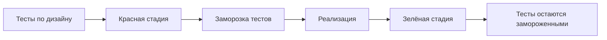

# Парадигма тестирования

> **Статус:** устойчивые принципы, уровни и текущее состояние тестов.
> **Источник ожидаемого поведения:** [`docs/game-design_v1.md`](game-design_v1.md).
> **Источник границ и зависимостей:** [`docs/architecture.md`](architecture.md).
> **Обязательный порядок разработки:** TDD — тесты, красная стадия,
> заморозка, реализация; см. §3 и [`AGENTS.md`](../AGENTS.md).
> **Текущий план и порядок внедрения:** [`plans/testing-strategy.md`](../plans/testing-strategy.md).
> **Фактическое состояние механик:** [`docs/status.md`](status.md).

## 1. Роль документа

`docs/testing.md` отвечает на вопрос «как мы тестируем и к чему стремимся».
Это стабильная часть состояния проекта: принципы, уровни, границы
ответственности и текущая картина покрытия.

`plans/testing-strategy.md` отвечает на другой вопрос — «что и в каком порядке
делаем дальше». План может меняться от этапа к этапу, парадигма — нет.
Факты о реализованных механиках и известных расхождениях остаются в
[`docs/status.md`](status.md).

## 2. Принципы

1. **TDD: тест раньше реализации.** Новое поведение сначала описывается
   тестом, который падает из-за отсутствия логики, затем тест замораживается,
   и только после этого пишется реализация. Порядок и границы — в §3.
2. **Ожидаемое поведение берётся из дизайна.** Источник истины для тестов —
   [`docs/game-design_v1.md`](game-design_v1.md), а не текущая реализация.
3. **Тест не подгоняется под баг.** Если тест и код расходятся, сначала
   выясняется, что неверно: тест или код. Ослаблять проверку нельзя.
4. **Замороженный тест не меняется.** После красной стадии тестовый файл и
   его фикстуры/хелперы неизменны до явного разрешения пользователя.
5. **Детерминизм.** Фиксированные таймеры, seeded RNG, маленькие фикстуры.
   Тест не должен зависеть от реального времени, порядка `Object.keys` или
   глобального состояния предыдущего теста.
6. **Публичные контракты.** Поведение проверяется через публичные методы,
   события и сериализацию, а не через приватные поля классов.
7. **Слоистость.** Unit-тесты логики не импортируют store, UI и Yandex SDK.
   Встреча логики со store происходит только в integration-тестах bridge.
8. **Один уровень не заменяет другой.** Unit не заменяет integration,
   integration не заменяет component и E2E.
9. **Контент — тоже контракт.** `src/data/*.json` проверяется тестом на схему,
   ссылки, диапазоны и отсутствие производных полей.
10. **Два формата сериализации проверяются раздельно.**
    `serializeForStore` — форматированные строки для UI;
    `serializeForSave` — lossless-строки. Смешивать их в тестах нельзя.
11. **Известный баг фиксируется тестом.** Используется `test.fails` с
    комментарием и ссылкой на [`docs/status.md`](status.md); после исправления
    тест становится обычным.
12. **Реализация без тестов не начинается.** Новая механика априори не
    реализуется до написания тестов: сначала тесты, красная стадия и
    заморозка, затем код.
13. **Тест описывает полную зону ответственности.** Ожидание строится из
    полной механики модуля по дизайну, а не из текущего этапа интеграции.
    Нулевое значение параметра не означает отсутствие механики; тест не
    закрепляет неполную реализацию как правильное поведение. Подробнее — §3.1.
14. **Тест инвариантен к значениям контента.** Ожидание выводится из правила
    дизайна, явно заданных входов теста или снимка логики, а не из текущего
    числа в `src/data/*.json`. Стартовые `count`, `storage`, `owned` и другие
    контентные величины не записываются в интеграционные ожидания константой,
    если само значение не является правилом дизайна (например, единственное
    главное здание). Тест должен оставаться верным при изменении контента,
    если механика не изменилась. Контент-тест — исключение: он по определению
    закрепляет контракт данных. Подробнее — §3.1.

## 3. TDD-цикл и заморозка тестов

Для новой механики, нового поведения или изменения контракта из документации
порядок обязателен:

1. **Тесты.** Пишутся тесты на ожидаемое поведение из
   [`docs/game-design_v1.md`](game-design_v1.md) и на границы из
   [`docs/architecture.md`](architecture.md). Проверяется публичный контракт:
   методы, события, сериализация, а не внутренние поля.
2. **Красная стадия.** Тесты запускаются и должны упасть именно из-за
   отсутствия логики. Причина падения фиксируется в отчёте о задаче.
   Проходящий без реализации тест поведение не подтверждает и переписывается.
3. **Заморозка.** Тестовый файл и используемые им фикстуры/хелперы из
   `src/test/` фиксируются. Их нельзя менять, удалять, ослаблять проверки
   или помечать `skip`/`todo` без явного разрешения пользователя.
4. **Реализация.** Код пишется до зелёного прогона. Подгонять тест под
   реализацию запрещено. Если тест оказался неверным, это отдельный вопрос
   к пользователю, а не правка по ходу.
5. **Зелёная стадия.** Тесты задачи проходят, полный `npm run test` зелёный.
   Заморозка сохраняется и дальше: тест остаётся неизменным до нового задания.

Границы применимости:

- TDD — для разработки вперёд. Уже реализованные модули не переписываются
  под TDD; их покрытие идёт по прежним правилам.
- Новые случаи в существующем тесте — отдельное изменение: согласование,
  добавление случаев до реализации, повторная заморозка.
- Задачи без нового поведения (рефакторинг, документация, конфигурация)
  TDD-цикл не требуют, но существующие тесты должны оставаться зелёными.
- `test.fails` фиксирует известный баг после реализации и не заменяет
  красную стадию.

### 3.1. Полнота зоны ответственности

Тест описывает полную зону ответственности модуля из дизайна, а не только тот
этап интеграции, который реализован сейчас.

- Если механика уже принадлежит модулю, тест обязан моделировать её целиком,
  даже когда часть значений пока нулевая. `storage: 0` — это нулевая
  вместимость, а не отсутствие механики складов. Склады и порча — зона
  ответственности `ResourceManager`, независимо от того, подключены ли бонусы
  зданий.
- Нельзя закреплять в тесте отсутствие механики как ожидаемое поведение.
  Например, `Wood = 396` после первого тика верно только при нулевом складе и
  отсутствии `CentralBase`; по дизайну стартовый `CentralBase` даёт склад.
  Но и число `400` не должно быть захардкожено: тест выводит ожидание из правила
  §5.4 (`lost = max(0, count − storage) × spoilRate`) по снимку и потому
  одинаково верен при `storage = 0` и при `storage = 400`.
- Characterization-тест уже реализованного модуля фиксирует факт, но не
  является спецификацией новой механики и не получает защиту заморозки
  красной стадии. Если дизайн требует другого поведения, тест признаётся
  устаревшим и обновляется отдельной задачей с явным разрешением пользователя.
- Тест интеграции должен собирать доменно полное начальное состояние:
  базовую вместимость, бонусы складов, стартовые здания и ресурсы. Ожидание не
  должно зависеть от того, какой слой ещё не подключён.
- Ожидание инвариантно к значениям контента. Если тесту нужно конкретное
  число, он задаёт вход сам (фикстура) или выводит ожидание из снимка;
  стартовые `count`, `storage`, `owned` и другие величины из
  `src/data/*.json` не записываются в ожидание константой, если это не
  правило дизайна (например, единственное главное здание).
- Проверка «снимок отражает текущий контент» допустима, но ожидание
  вычисляется из импортированного контента или сравнивается со снимком
  логики. Контент-тест (`src/data/content.test.ts`) — исключение: он
  закрепляет значения данных как контракт.
- Если полная механика пока не интегрирована, это фиксируется как известное
  расхождение в [`docs/status.md`](status.md), а не как «правильное» ожидание
  в тесте.

## 4. Уровни тестирования

| Уровень | Что проверяет | Окружение | Инструмент | Текущий статус |
|---|---|---|---|---|
| Unit | Формулы, границы, сериализация, EventBus | Node | Vitest | ✅ |
| Integration | Системы + EventBus + bridge + store + save | Node / jsdom | Vitest | ✅ |
| Content | Схема и ссылки `src/data/*.json` | Node | Vitest | ✅ |
| Component | Рендер, клики, состояния UI | jsdom | Vitest + RTL | ⛔ позже |
| E2E | Реальный браузер, статический билд, SDK-моки | Chromium | Playwright | ⛔ позже |
| Manual | Яндекс.Игры: sandbox, реклама, cloud saves | Yandex sandbox | Чек-лист | ⛔ позже |

## 5. Границы слоёв в тестах

- **Unit логики** (`src/logic/**/*.test.ts`) проверяет модули через их
  публичные методы и `EventBus`. Store, React и Yandex SDK здесь запрещены.
- **Integration** (`src/integration/**/*.test.ts`) — единственное место, где
  логика встречается со store через bridge. Здесь проверяются `tick`,
  `speed:changed`, `loadGame`, идемпотентность `init` и `dispose`.
- **Content** (`src/data/content.test.ts`) проверяет только данные: уникальные
  `id`, ссылки на ресурсы, числовые строки, регистр `BuildPower`, обязательные
  поля, диапазоны и отсутствие производных полей.
- **Component** (позже) проверяет UI через store и публичные команды; UI не
  читает состояние логики напрямую.
- **E2E** (позже) работает с реальным браузером; Yandex SDK подменяется моком,
  чтобы платформа не протекала в логику.
- **`src/test/`** — инфраструктура тестов (setup, fixtures, helpers, mocks),
  а не доменный слой и не место для самих тестов.

## 6. Текущее состояние

Снимок на 2026-11-26:

- раннер — Vitest 4.1.12, окружение по умолчанию `node`;
- jsdom включается docblock-ом `// @vitest-environment jsdom` только для
  `GameManager` и `GameLoop`;
- 16 тестовых файлов, 237 passed;
- покрытие — `npm run test:coverage`; приоритетные зоны — `src/logic` и
  `src/integration`.

Покрыто:

- `EventBus` — 10 тестов;
- `Resource` — 33;
- `ResourceManager` — 44 (лимит истории баланса реализован, `test.fails` больше нет);
- `GameManager` — 12;
- `GameLoop` — 19 (включая SSR-guard);
- `storeBridge` — 13;
- `SaveManager` — 7;
- контент-валидация — 24;
- `Building` — 14;
- `BuildingManager` — 38;
- `EconomySystem.buildings` — 4;
- конец хода и порядок фаз зданий `EconomySystem` — производство, строительство,
  износ/ремонт, порча излишков, лимит истории, сброс потоков.

Пока не покрыто:

- `PopulationSystem` и фазы населения;
- UI-компоненты;
- E2E;
- Yandex SDK, cloud saves, реклама, лидерборды.

## 7. Организация

- Тесты лежат рядом с кодом: `src/logic/**/*.test.ts`,
  `src/integration/**/*.test.ts`, позже `src/components/**/*.test.tsx`.
- Контент-тест лежит рядом с данными: `src/data/content.test.ts`.
- Общая инфраструктура — `src/test/`: `setup.ts`, `fixtures/`, `helpers/`,
  позже `mocks/`.
- `setup.ts` очищает `localStorage` и сбрасывает глобальные синглтоны
  `globalThis.__gameLoop`/`__gameManager`.
- Coverage включает `src/logic/**` и `src/integration/**`; легаси-модули
  исключены до своей реализации.
- Команды: `npm run test`, `npm run test:watch`, `npm run test:coverage`.

## 8. Quality gates

- Локально и в PR: `npm run lint`, `npx tsc --noEmit`, `npm run test`,
  `npm run build`.
- E2E — отдельный job или nightly, чтобы не замедлять каждый PR.
- Coverage — приоритет `src/logic/**` и `src/integration/**`, без гонки за
  100% по всему проекту.
- Yandex sandbox — ручной release gate, не в CI.

## 9. Политика известных багов

1. Тест пишется на ожидаемое поведение из дизайна.
2. Если текущий код не соответствует, тест помечается `test.fails` с
   комментарием и ссылкой на [`docs/status.md`](status.md).
3. Тест не удаляется и не ослабляется.
4. После исправления `.fails` убирается, тест становится обычным.
5. `test.fails` не заменяет красную стадию TDD: для новой разработки тест
   сначала падает по-настоящему, а не маскируется под известный баг.
6. Перевод замороженного теста в `test.fails` — изменение замороженного
   теста и требует явного разрешения пользователя.

## 10. Цели и приоритеты

- Уже работающие модули покрываются characterization-тестами по прежним
  правилам; новые механики разрабатываются по TDD: тесты → красная стадия →
  заморозка → реализация.
- Приоритет — детерминированная симуляция, приоритеты дефицита, сохранения и
  границы слоёв.
- Контент-валидация должна ловить расхождения схемы до UI и ручной проверки.
- Component и E2E добавляются после стабилизации логики и появления панелей.
- Yandex SDK тестируется через адаптер и мок; реальный SDK в тестах не
  используется.

## 11. Связь с другими документами

| Документ | Роль |
|---|---|
| [`docs/game-design_v1.md`](game-design_v1.md) | Ожидаемое поведение и правила |
| [`docs/architecture.md`](architecture.md) | Границы слоёв и тестовые инварианты |
| [`docs/status.md`](status.md) | Факты: что покрыто, что нет, известные баги |
| [`plans/testing-strategy.md`](../plans/testing-strategy.md) | Текущий план и порядок внедрения |
| [`docs/decisions.md`](decisions.md) | Почему выбраны раннер и организация тестов |
